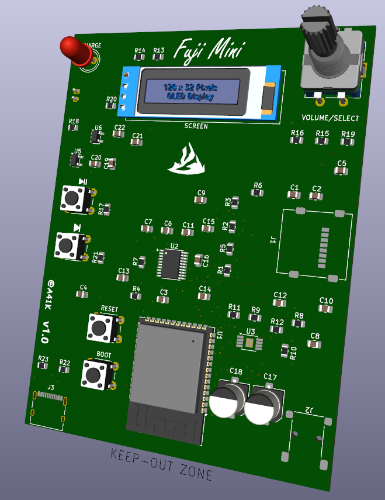
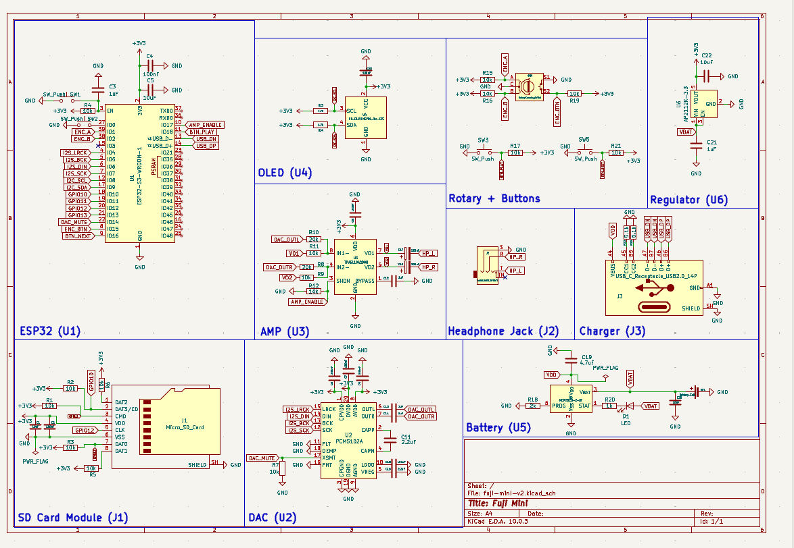
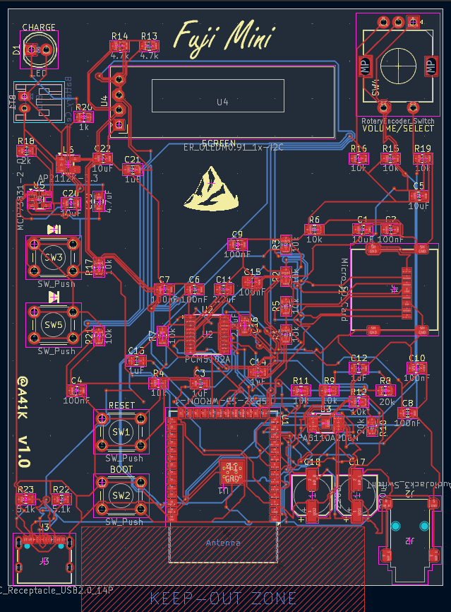

THIS WAS BUILT FOR ARDUINO / ESP-32 SOFTWARE
ANY ISSUES FOUND PLEASE REPORT IT TO ME

## Fuji Mini v2

A small Pocket-sized Music player in the palm of your hands

Main Features:
- ESP-32-S1-WROOM as MCU
- Boot / Reset onboard buttons
- Built in DAP, Battery managment, Charger, AMP
- 0.91 inch Screen
- Re-programable software (/Firmware/firmware.ino)
- micro-SD card reading functionality
- USB-C for charging
- Battery indicator LED
- Rotary + Button for controls and volume
- Play / Forward buttons seperately
- 3.5 inch Headphone jack for analog sound

## Schematic:

- The schematic is organized and labeled with the different parts and uses
- You can use the other unused GPIO pins (didn't put a no flag for that)

## PCB:

- Everything can be hand soldered and put on.
- Only the battery connector is on the other side

- You need the exact amount of caps and res with the specific values to build it. Check the BOM.csv for that

## BOM:

| Part | What it's for | Qty | Unit | Total | Vendor |
| --- | --- | --- | --- | --- | --- |
| [Battery connector](https://hqelektronika.hu/csatlakozok/egyeb-csatlakozok/csat-17021b90-egysoros-csatlakozo-aljzat-apa-pcb-jst-ph-2p-tav-2-0mm-90?cid=18094&cikkszam=CSAT-17021%2FB90) | Connector | 2 | $0.21 | $0.42 | HQelektronika |
| [10uF](https://hqelektronika.hu/passziv-alkatreszek/kondenzatorok/smd-keramia-kondenzatorok/smdc-10uf-0805-25-smd-kondenzator-25v-10uf-10-x5r?cid=75979&cikkszam=SMDC+10UF+0805-25) | Capacitor | 5 | $0.06 | $0.30 | HQelektronika |
| [100nF](https://hqelektronika.hu/passziv-alkatreszek/kondenzatorok/smd-keramia-kondenzatorok/smdc-100n-0805-smd-kondenzator-50v-100nf-10-x7r?cid=47620&cikkszam=SMDC+100N+0805) | Capacitor | 8 | $0.03 | $0.24 | HQelektronika |
| [1uF](https://hqelektronika.hu/passziv-alkatreszek/kondenzatorok/smd-keramia-kondenzatorok/smdc-1-0u-0805-25-smd-kondenzator-25v-1uf-10-x7r?cid=75996&cikkszam=SMDC+1.0U+0805-25) | Capacitor | 5 | $0.04 | $0.20 | HQelektronika |
| [2.2uF](https://hqelektronika.hu/passziv-alkatreszek/kondenzatorok/smd-keramia-kondenzatorok/smdc-2-2u-0805-smd-kondenzator-25v-2-2uf-10-x7r?cid=47660&cikkszam=SMDC+2.2U+0805) | Capacitor | 5 | $0.05 | $0.25 | HQelektronika |
| [220uF](https://hqelektronika.hu/passziv-alkatreszek/kondenzatorok/elektrolit-kondenzator/22016smd-105-elektrolit-kondenzator-220uf-16v-105c-smd6-3?cid=1853&cikkszam=220%2F16SMD-105) | Capacitor | 2 | $0.22 | $0.44 | HQelektronika |
| [Micro_SD_Card](https://www.hestore.hu/prod_10035282.html) | MicroSD card connector | 1 | $2.00 | $2.00 | hestore |
| [AudioJack](https://hqelektronika.hu/csatlakozok/audio-video-csatlakozok/jc-1132s-jack-3-5mm-aljzat-sztereo-nyakos-smd?cid=28732&cikkszam=JC-113%2F2S) | 3.5 mm jack | 1 | $1.71 | $1.71 | HQelektronika |
| [10k](https://hqelektronika.hu/passziv-alkatreszek/ellenallasok/smd-ellenallasok/smd-10k-0805-1-0-125w-thick-film-0805-smd-ellenallas-10k-1) | Resistor | 15 | $0.02 | $0.30 | HQelektronika |
| [20k](https://hqelektronika.hu/passziv-alkatreszek/ellenallasok/smd-ellenallasok/smd-22k-0805-0-125w-chip-ellenallas-22k-5?cid=47440&cikkszam=SMD+22K+0805) | Resistor | 10 | $0.01 | $0.10 | HQelektronika |
| [4.7k](https://hqelektronika.hu/passziv-alkatreszek/ellenallasok/smd-ellenallasok/smd-4k7-0805-0-125w-thick-film-0805-smd-ellenallas-4-7k-5?cid=47526&cikkszam=SMD+4K7+0805) | Resistor | 10 | $0.01 | $0.10 | HQelektronika |
| [2k](https://hqelektronika.hu/passziv-alkatreszek/ellenallasok/smd-ellenallasok/smd-2k2-0805-0-125w-thick-film-0805-smd-ellenallas-2-2k-5?cid=47461&cikkszam=SMD+2K2+0805) | Resistor | 10 | $0.02 | $0.20 | HQelektronika |
| [1k](https://hqelektronika.hu/passziv-alkatreszek/ellenallasok/smd-ellenallasok/smd-1k-0805-0-125w-thick-film-0805-smd-ellenallas-1k-5?cid=47416&cikkszam=SMD+1K+0805) | Resistor | 10 | $0.02 | $0.20 | HQelektronika |
| [5.1k](https://hqelektronika.hu/passziv-alkatreszek/ellenallasok/smd-ellenallasok/smd-5k1-0805-0-125w-thick-film-0805-smd-ellenallas-5-1k-5?cid=78466&cikkszam=SMD+5K1+0805) | Resistor | 10 | $0.02 | $0.20 | HQelektronika |
| [ESP32-S3-WROOM-1](https://shop.ret.hu/aktiv-alkatreszek-integralt-aramkorok-modulok/analog-integralt-aramkorok/hang--es-nagyfrekvencias_rf_-aramkorok-modulok/rf-modulok/76-16-65) | Microcontroller | 1 | $6.02 | $6.02 | shop.ret.hu |
| [PCM5102A](https://www.microcontroller.hu/termek/pcm5102a-i2s-dac-internet-radio-modul/) | DAC decoder | 1 | $4.57 | $4.57 | microcontroller.hu |
| [TPA6110A2DGN](https://www.aliexpress.com/item/1005010338743602.html) | Amplifier | 1 | $1.50 | $1.50 | AliExpress |
| [ER_OLEDM0.91_1x-I2C](https://sigmanortec.ro/hu/kijelzo-oled-iic-i2c-091-128x32?SubmitCurrency=1&id_currency=4) | Display | 1 | $4.23 | $4.23 | sigmanortec |
| [MCP73831-2-MC](https://hu.rs-online.com/web/p/akkumulatorkezeles/7386360) | Charging module | 1 | $3.93 | $3.93 | RS Online |
| [AP2112K-3.3](https://www.hestore.hu/prod_10047483.html) | Voltage regulator | 1 | $0.41 | $0.41 | hestore |
| [U262-161N-4BVC11](https://jlcpcb.com/partdetail/U262-161N-4BVC11/C319148) | USB-C connector | 1 | $0.39 | $0.39 | JLCPCB |
| **Parts subtotal** | | | | **$27.71** | |
| **Tax & shipping** | | | | **$5.28** | |
| **Total** | | | | **$32.99** | |

